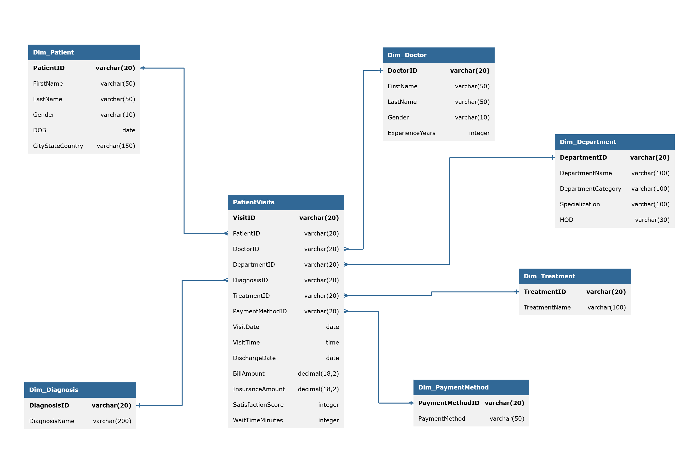

# SQL_Hospital_CaseStudy
# Hospital Visits Analysis (MySQL)

SQL analysis of a hospital database covering patient visits, doctors, departments, diagnoses, treatments, and payments. The project cleans the raw dimension tables, then answers business questions on revenue, patient demographics, doctor performance, and visit trends.

## Database Schema



| Table | Description |
|---|---|
| `PatientVisits` (fact) | One row per visit: dates, bill amount, insurance amount, satisfaction score, wait time |
| `Dim_Patient` | Patient name, gender, DOB, city/state/country |
| `Dim_Doctor` | Doctor name, gender, years of experience |
| `Dim_Department` | Department name, category, specialization, head of department |
| `Dim_Diagnosis` | Diagnosis names |
| `Dim_Treatment` | Treatment names |
| `Dim_PaymentMethod` | Payment methods |

## Tools

- MySQL 8
- MySQL Workbench / DBeaver

## Data Cleaning

Created `DIM_Patient_Clean` from `Dim_Patient`:

- Removed rows with missing `FirstName`
- Standardized first and last names to proper case and trimmed whitespace
- Expanded gender codes (`M` / `F`) to `Male` / `Female`
- Split `CityStateCountry` into separate `City`, `State`, and `Country` columns using `SUBSTRING_INDEX`

A cleaned department table (`Dim_Department_Clean`) is also used in the department queries.

## Questions Answered

| # | Question | Key Techniques |
|---|---|---|
| 1 | Distinct patients treated by each doctor | `COUNT(DISTINCT)`, joins |
| 2 | Revenue split by payment method with total visits | Aggregation, joins |
| 3 | Average bill by patient age group (age at time of visit) | CTE, `CASE`, `TIMESTAMPDIFF` |
| 4 | Total revenue and visits per department | Aggregation |
| 5 | Rank departments by revenue within each department category | `RANK()`, `PARTITION BY` |
| 6 | Average satisfaction score and wait time per department | `AVG`, `CAST` |
| 7 | Weekday vs weekend visits | `CASE`, `DATE_FORMAT` |
| 8 | Monthly visits with running cumulative total | Window `SUM() OVER` |
| 9 | Doctors with highest average satisfaction (min. 100 visits) | `HAVING` |
| 10 | Most commonly prescribed treatment per diagnosis | CTE, `RANK()` |
| 11 | Monthly net revenue per doctor with 3-month moving average | `AVG() OVER`, `ROWS BETWEEN 2 PRECEDING AND CURRENT ROW` |
| 12 | Top 5 spenders per city (net of insurance) | CTE, `RANK()`, `PARTITION BY` |
| 13 | Monthly visits per department and change from previous month | `LAG()`, running total |

More questions are being added.

## SQL Concepts Practiced

- Joins across a star-schema (fact + dimension tables)
- CTEs and subqueries
- Window functions: `RANK`, `LAG`, running totals, moving averages
- `CASE` expressions for categorization
- Date functions: `TIMESTAMPDIFF`, `DATE_FORMAT`
- String functions: `CONCAT`, `TRIM`, `SUBSTRING_INDEX`
- Data cleaning and standardization

## Repository Structure

```
├── README.md
├── erd.png
├── data_cleaning.sql
└── analysis_queries.sql
```

## How to Run

1. Create the database and load the source tables.
2. Run `data_cleaning.sql` to build the cleaned dimension tables.
3. Run queries from `hospital_analysis_queries.sql`.
